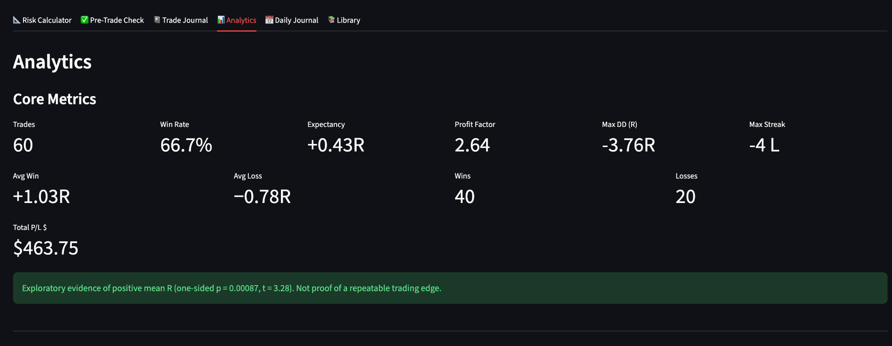
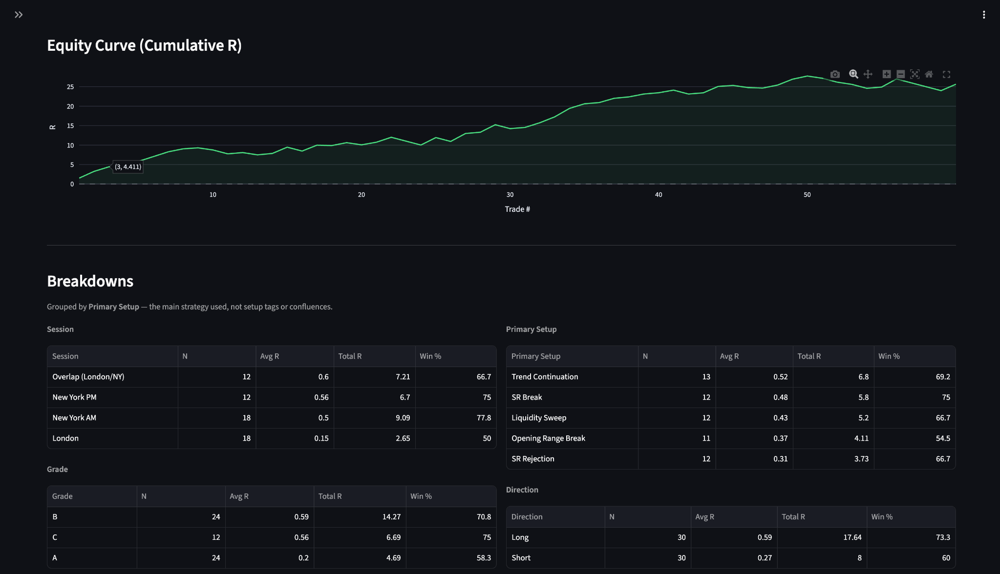
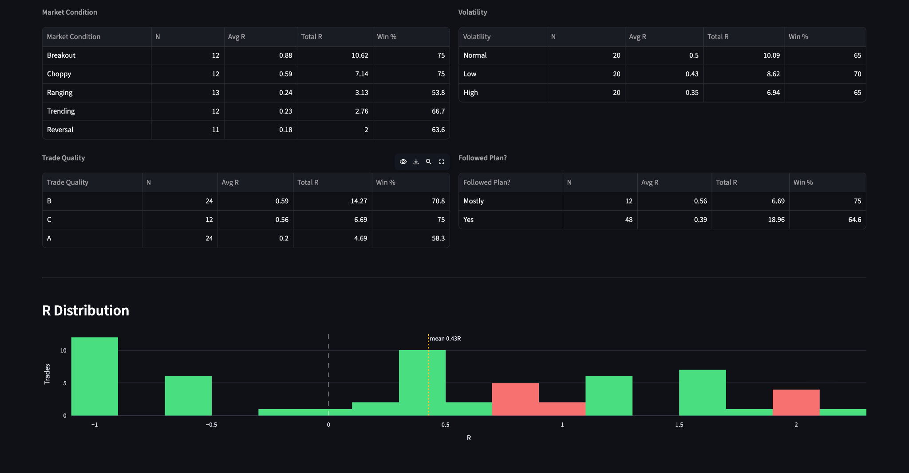
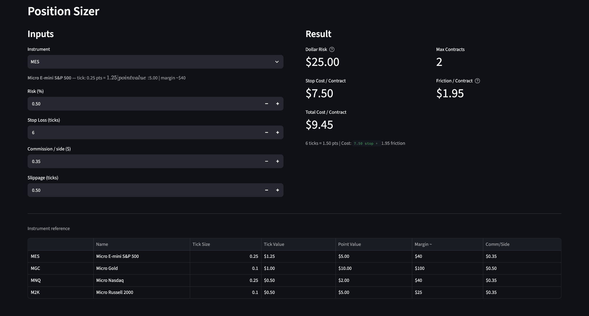
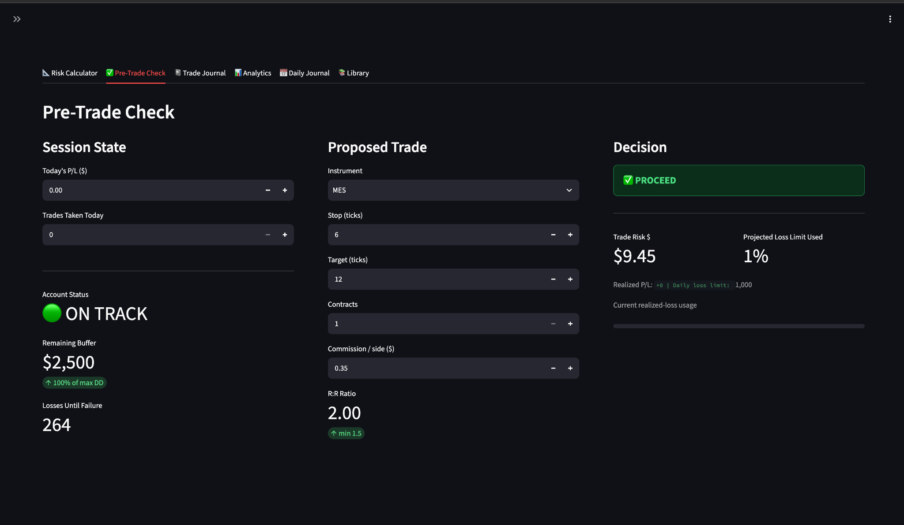
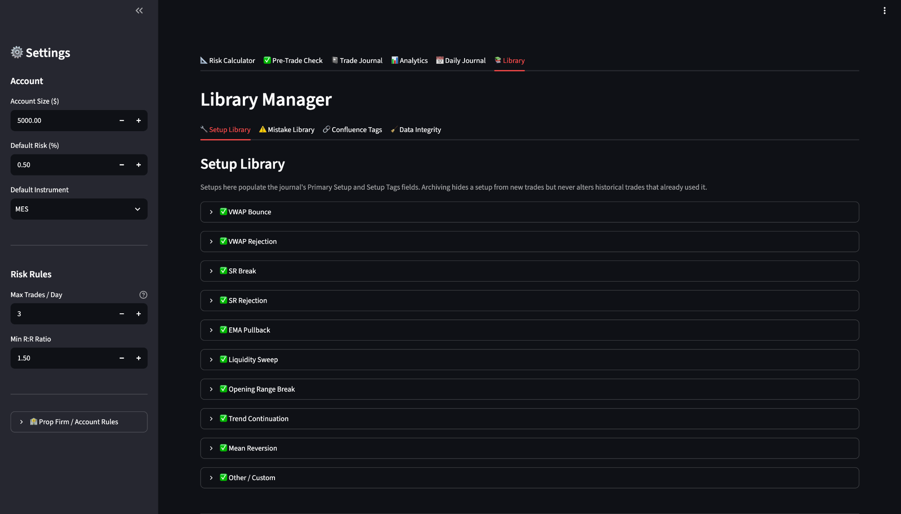

# Futures Risk Modeler

**Python · Streamlit · pandas · NumPy · SciPy · Plotly · openpyxl**

A local, single-user application for futures position sizing, pre-trade risk checks, structured trade journaling, and exploratory trading-performance analytics. It includes predefined contract specifications for MES, MGC, MNQ, and M2K, and a companion Excel workbook.

> **Demonstration data disclosure:** Every performance metric, P/L value, chart, table, and statistical result shown in the screenshots below comes from **60 entirely synthetic, fictional trades** in [`data/demo_trades_60.csv`](data/demo_trades_60.csv). These numbers are provided only to demonstrate the software. They do **not** represent live trades, verified strategy returns, personal trading performance, or evidence of a profitable trading edge. The sample account settings in the other screenshots are illustrative as well.



*Analytics overview — synthetic demo data. The displayed positive returns and statistical p-value describe fictional observations only.*

## Features

| Component | Implemented functionality |
| --- | --- |
| **Risk calculator** | Position sizing using stop distance, tick value, commission, and assumed slippage |
| **Pre-trade check** | `PROCEED`, `WARN`, `REDUCE`, or `BLOCK` decisions for defined risk constraints |
| **Trade journal** | Fast and detailed trade entry, editing, structured reviews, tags, and optional screenshots |
| **Performance analytics** | Win rate, expectancy in R, profit factor, drawdown, cumulative R, R distribution, and grouped summaries |
| **Daily journal** | Pre-session planning and post-session reflections |
| **Setup library** | Editable setup, mistake, and confluence categories |
| **Excel companion** | A separate workbook for manual tracking, generated using `build_excel.py` |

## Application preview

All screens in this section use **fictional trades or illustrative account settings**. None of the depicted results should be interpreted as actual trading results.

### Performance analytics: equity curve and grouped results

The application summarizes returns in units of initial risk (R) and groups results by trading session, primary setup, grade, and other journal fields.



*Illustrative cumulative-R curve and group-level metrics computed from the 60-trade demo CSV.*

<details>
<summary><strong>More analytics: market conditions, volatility, and R distribution</strong></summary>

The additional tables demonstrate breakdowns by market condition, volatility, trade quality, and whether the plan was followed. The histogram displays the distribution of fictional R outcomes.



</details>

### Risk-based position sizing

The position sizer estimates contract quantity from account risk percentage, stop distance, contract specifications, commissions, and slippage assumptions. The values below are sample inputs, not a recommendation for any live account.



### Pre-trade risk checks

The pre-trade checker evaluates the proposed trade against configured position-size, daily-loss, drawdown-buffer, stop-distance, and risk/reward constraints. It can return `PROCEED`, `WARN`, `REDUCE`, or `BLOCK` based on the inputs.



*This screenshot shows a sample `PROCEED` result. It does not show an actual executed trade or guarantee that an account satisfies a broker's or prop firm's rules.*

<details>
<summary><strong>Setup library and account settings</strong></summary>

Setup definitions populate the trade journal's classifications; archived setups can remain associated with historical trades.



</details>

## Getting started

### Requirements

- Python 3.10 or newer
- Dependencies in `requirements.txt`
- A local terminal or development environment such as GitHub Codespaces

From the repository root:

```bash
python3 -m venv .venv
source .venv/bin/activate  # On Windows: .venv\Scripts\activate
python -m pip install -r requirements.txt
python -m streamlit run app.py
```

Streamlit usually opens at `http://localhost:8501`. In GitHub Codespaces, open the forwarded port **8501** in a browser.

### Load the synthetic 60-trade demo

The public repository includes two distinct example datasets:

| Dataset | Purpose |
| --- | --- |
| [`data/demo_trades_60.csv`](data/demo_trades_60.csv) | **60 fully fictional trades** used for the screenshots and analytics demonstration |
| [`data/sample_trades.csv`](data/sample_trades.csv) | 15 sample trades in an older journal schema, useful for demonstrating migration |

The application reads active trade records from **`data/trades.csv`**, which is a local file excluded from Git. To run the same analytics demonstration shown above, first back up any personal `data/trades.csv` you want to keep, then copy in the demo dataset:

```bash
cp data/demo_trades_60.csv data/trades.csv
python -m streamlit run app.py
```

**Caution:** The `cp` command overwrites an existing `data/trades.csv`. Do not run it over real records without preserving a separate backup. The `data/trades.csv` file is intentionally not published. To exercise the legacy migration path instead, copy `data/sample_trades.csv` to `data/trades.csv`.

## Architecture and data storage

- **`app.py`** provides the Streamlit interface and orchestrates calls to the modules.
- **`modules/`** contains the risk calculations, analytics, validation, journal operations, schema migration, libraries, and media handling.
- **CSV** stores trade and daily-journal records; **JSON** stores setup/tag libraries and image metadata; screenshot images are stored in local per-trade folders.
- Trades are saved before attached screenshots. Schema migrations create a CSV backup before adding columns, while delete/bulk-edit operations use the backup manager.
- The application is designed for a **local single user**. It does not use a database server or connect to a trading platform.

### Project structure

```text
futures-risk-modeler/
├── app.py                         # Streamlit user interface
├── modules/                       # Calculation, analytics, storage, and validation
├── tests/                         # Automated regression tests
├── assets/                        # Screenshots used in this README
│   ├── analytics-overview.png
│   ├── equity-curve-and-setups.png
│   ├── r-distribution-and-conditions.png
│   ├── position-sizing.png
│   ├── pre-trade-check.png
│   └── setup-library.png
├── data/
│   ├── demo_trades_60.csv         # Synthetic screenshots/demo dataset
│   └── sample_trades.csv          # Legacy-schema sample
├── build_excel.py                 # Excel workbook generator
├── futures_risk_modeler.xlsx     # Companion workbook
├── example_config.json           # Illustrative account settings
├── requirements.txt
├── .gitignore
└── README.md
```

## Run the tests

```bash
python -m unittest discover -s tests -v
```

The included regression tests cover risk checks, position sizing, trade analytics, tag serialization, input validation, and preservation of old CSV values during schema migration. Passing tests verify the covered scenarios; they do not guarantee the application is error-free.

## Assumptions and limitations

- **Synthetic data:** The analytics screenshots use fabricated observations. In particular, the displayed P/L, expectancy, equity curve, and one-sided t-test p-value are **not evidence of real-world performance**.
- **Exploratory inference:** The mean-R t-test assumes independent observations and does not account for repeated testing, strategy selection, correlated trades, or changing market conditions. Its result should not be interpreted as confirmation of a trading edge.
- **Risk estimates:** Position size and pre-trade decisions depend on user-provided stops, commission, slippage, account figures, and simplified drawdown rules. Realized losses can exceed model estimates.
- **Account rules:** `example_config.json` includes illustrative prop-firm settings, not verified current terms. Actual provider rules may differ.
- **Scope:** No order execution, broker connectivity, automated backtesting, predictive machine learning, or Monte Carlo simulation is implemented.
- **Persistence:** Local CSV, JSON, and image files are intended for a single-user environment. Sidebar account settings are not saved across restarts; cloud environments with ephemeral storage require additional persistence.

This project is a risk-management and analytical journaling tool, not investment advice or a guarantee of compliance with any trading firm's rules.
